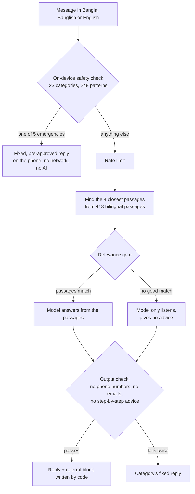

# Shomota Shurokkha (সমতা সুরক্ষা): GBV Awareness, Reporting and Support App

A bilingual (Bangla and English) mobile app from **WaterAid Bangladesh** that gives staff, partners and community members one place to learn about gender-based violence (GBV) and safeguarding, find the right help quickly, and raise a concern.

It includes **Bharosha (ভরসা)**, a safety-first AI assistant that listens, explains, and connects the person to a human. It does not counsel, give legal advice or take reports.

> **Note:** Shared publicly with WaterAid Bangladesh's permission for portfolio and review purposes. Firebase configuration, signing keys, API keys and all user data are excluded. See [What is not in this repository](#what-is-not-in-this-repository).

---

## At a glance

| | |
|---|---|
| **Organisation** | WaterAid Bangladesh |
| **Platform** | Flutter (Android first; web and iOS builds possible) |
| **App back end** | Firebase Authentication, Cloud Firestore, Firebase Storage |
| **AI assistant** | Python 3.11, FastAPI, fastembed (quantised ONNX embeddings), LangChain, Groq-hosted open-weight model |
| **Languages** | Bangla, romanised Bangla ("Banglish") and English |
| **Status** | App published on the Play Store. Bharosha works end to end on a developer machine and is waiting for WaterAid safeguarding sign-off before deployment |

---

## Credits

**Phase 1: core app.** Developed by **Moumita Khandaker** (then at WaterAid Bangladesh) under the close guidance of **Ponuel Mollah Swadesh**, ICT Officer, WaterAid Bangladesh. This phase delivered the Flutter app, Firebase sign-up and login with email verification, the Knowledge Hub, emergency contacts, the incident report form and the admin screens for managing content.

**Phase 2: Bharosha assistant and hardening.** Led and built by **Ponuel Mollah Swadesh**: the Bharosha service and its in-app chat, the on-device safety layer, the bilingual knowledge corpus, the test suite, and security fixes to the app.

---

## Features

**For everyone (no login needed)**
- **Knowledge Hub:** short bilingual guides on GBV, safeguarding, consent and workplace safety, with videos and illustrated PDF guides
- **Emergency contacts:** national helplines and partner safeguarding focal points, with one tap to call or email
- **Bharosha chat:** ask a question in Bangla, Banglish or English and get a calm, plain answer plus the right human contact
- Language switch between Bangla and English across the whole app

**For signed-in users**
- Account with email verification and password reset
- Incident report form (date, time, district and upazila, type of concern, details) stored in Firestore

**For administrators**
- Add and edit Knowledge Hub topics and their content without a new app release

---

## How Bharosha keeps people safe

The design rule is **"safety decides, the AI speaks."**



- **Emergencies never wait for the AI.** Five emergency situations are recognised on the phone and answered at once from fixed text, even offline.
- **Numbers never come from the model.** Every phone number and email is added by code from one reviewed list (`bharosha_service/app/referrals.py`). The output check rejects any reply where the model wrote a digit or an email address itself.
- **It fails safe.** If there is no network, no API key, or the model gives a bad answer twice, the person still gets the complete pre-approved reply for their situation.
- **It is honest about limits.** Bharosha says plainly that it cannot take a report, and it never mentions an in-app reporting route until one is confirmed to work and to be read by a person.

Full design notes, measured results and open items are in [`bharosha_service/README.md`](bharosha_service/README.md) and [`bharosha_service/probe_results.md`](bharosha_service/probe_results.md).

---

## Project structure

```
shomota-shurokkha-gbv-app/
├── stop_gender_violence_fresh_ui/   Flutter app
│   ├── lib/
│   │   ├── screens/                 home, knowledge hub, report form, login, admin...
│   │   ├── bharosha/                chat screen, API client, on-device safety rules
│   │   └── utils/
│   └── assets/                      images, guides, bundled safety rules and referrals
└── bharosha_service/                Bharosha AI service (FastAPI)
    ├── app/                         safety layer, referrals, retrieval, prompt, API
    ├── corpus/                      418 bilingual passages (awaiting WaterAid review)
    ├── shared/                      generated JSON shared with the app
    ├── tests/                       offline and live test suites
    └── tools/                       probes, review tools, developer console
```

---

## Running it

### Flutter app

You need Flutter 3 and your own Firebase project.

```bash
cd stop_gender_violence_fresh_ui
flutterfire configure            # creates your own Firebase config files
flutter pub get
flutter run

# To connect Bharosha to a running service:
flutter run --dart-define=BHAROSHA_URL=http://10.0.2.2:8000
```

To make an account an administrator, set a custom claim from a trusted machine with the Firebase Admin SDK, for example in Node.js:

```js
admin.auth().setCustomUserClaims(uid, { admin: true });
```

Suggested Firestore security rules are in [`docs/firestore.rules.example`](docs/firestore.rules.example).

### Bharosha service

```bash
cd bharosha_service
python -m venv .venv && source .venv/bin/activate   # Windows: .venv\Scripts\activate
pip install -r requirements-dev.txt
cp .env.example .env                                # add your own GROQ_API_KEY
python -m pytest -q                                 # offline safety tests
uvicorn api:app --app-dir app --reload   # then open http://127.0.0.1:8000/health
```

The offline suite currently gives **364 passed, 146 skipped**. The skipped tests are the live behaviour tests, which run only against a running server with `BHAROSHA_BASE` set.

---

## What is not in this repository

- Firebase config files (`google-services.json`, `GoogleService-Info.plist`), Android signing keys and `key.properties`
- Any API key, including the Groq key. Bharosha reads `GROQ_API_KEY` from the environment only
- User accounts, reports or any other Firestore data
- The Probahini chatbot from another WaterAid app, which was used only as a reference while Bharosha was being built
- A hard-coded administrator login from the first phase. It was replaced with a Firebase custom-claim check before publishing

---

## What I learned

- **Put safety in code, not in the prompt.** A prompt can be talked around. A pattern match on the phone and a referral list written by code cannot.
- **Measure before you trust the model.** The retrieval check, the probe runs and the blind "feel" review gave numbers to argue with instead of impressions.
- **Design for the worst connection.** Many users are on weak mobile data, so the emergency path works with no network at all.
- **Never put admin credentials in an app.** Anything inside an APK can be read. Roles belong on the server, as custom claims plus security rules.

---

## Licence

Copyright © 2025 to 2026 WaterAid Bangladesh. Shared publicly with permission for portfolio and review purposes only. See [LICENSE.md](LICENSE.md).

## Maintainer

**Ponuel Mollah Swadesh**, ICT and Digital Development Officer, WaterAid Bangladesh
[swadeshmollah@gmail.com](mailto:swadeshmollah@gmail.com) · [GitHub](https://github.com/Swadesh1997)
